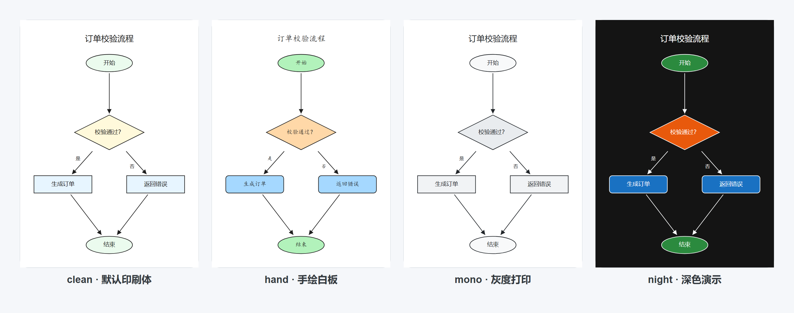

# wanger-skills

My personal collection of AI skills for Claude Code. 每个子目录是一个独立 Skill（包含 `SKILL.md`），可以直接复制或克隆到 `~/.claude/skills` 下使用。

[](https://github.com/8866nobug/wanger-skills/actions/workflows/tests.yml)
[](LICENSE)

## Skills

### Excalidraw 绘图引擎

> 用自然语言生成、读取、校验和增量修改 Obsidian Excalidraw 图表。
> 纯 Python 标准库 · 6 套样式 · 流程图 / UML / ER / 分组 / 经典 Chen 概念图 · 幂等 patch · 自动备份

<p align="center">
  <a href="excalidraw/README.md">
    
  </a>
</p>

| 能力 | 说明 |
|---|---|
| 图表模式 | 流程图、UML 类图、鸦爪 ER、业务域分组、经典 Chen 概念 ER |
| 样式 | `clean` / `er` / `chen` / `hand` / `mono` / `night` |
| 修改 | `patch` 按 `sem_id` 声明式对账，保留手拖位置与外观 |
| 安全 | 写入前校验、自动备份、原子写入 |
| 质量 | 137 个 `unittest`，GitHub Actions 覆盖 Python 3.10 / 3.12 / 3.13 |

- **完整文档**：[`excalidraw/README.md`](excalidraw/README.md)
- **样例**：[`excalidraw/examples/`](excalidraw/examples/)（JSON spec + 可直接打开的 `.excalidraw.md`）
- **Claude Code 入口**：[`excalidraw/SKILL.md`](excalidraw/SKILL.md)

#### 安装

**方式一：整个仓库作为 skills 目录（适合新环境）**

```bash
git clone https://github.com/8866nobug/wanger-skills.git ~/.claude/skills
```

**方式二：只安装 excalidraw（已有 `~/.claude/skills`）**

```bash
git clone https://github.com/8866nobug/wanger-skills.git /tmp/wanger-skills
cp -r /tmp/wanger-skills/excalidraw ~/.claude/skills/excalidraw
```

安装后在 Claude Code 中直接说「帮我画一张……」或使用 `/excalidraw`。

## 仓库结构

```
wanger-skills/
├── README.md              # 本文件（Skills 索引）
├── LICENSE
├── .github/workflows/     # 共享 CI
├── .gitignore
├── .gitattributes
└── excalidraw/            # Excalidraw Skill
    ├── SKILL.md           # Claude Code Skill 入口
    ├── README.md          # 详细文档与样例画廊
    ├── references/        # 元素 / 格式 / 布局 / 样式规范
    ├── scripts/           # Python 引擎 + 137 个单测
    ├── examples/          # 样例 spec 与 .excalidraw.md
    └── docs/              # 预览图与生成脚本
```

## 运行测试

```bash
git clone https://github.com/8866nobug/wanger-skills.git
cd wanger-skills/excalidraw/scripts
python -m unittest discover -s tests -t .
```

## License

[MIT](LICENSE)
