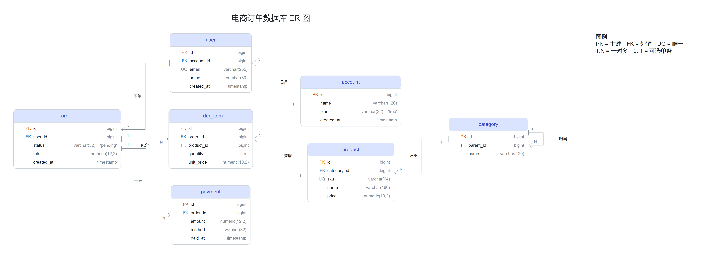
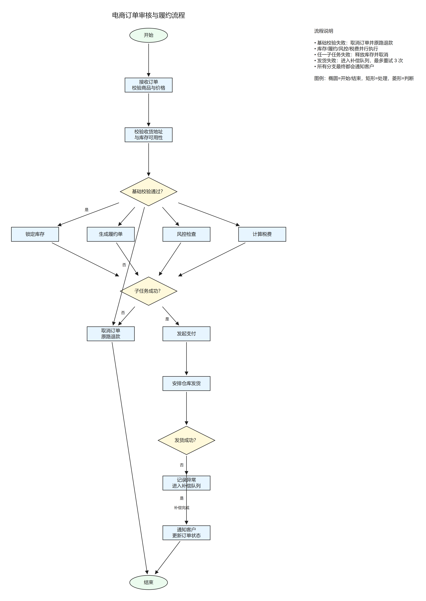
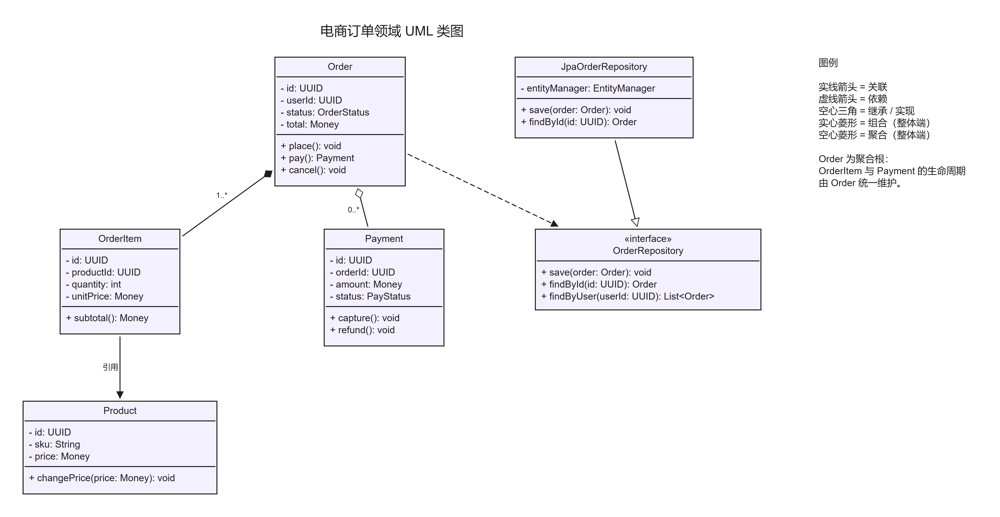
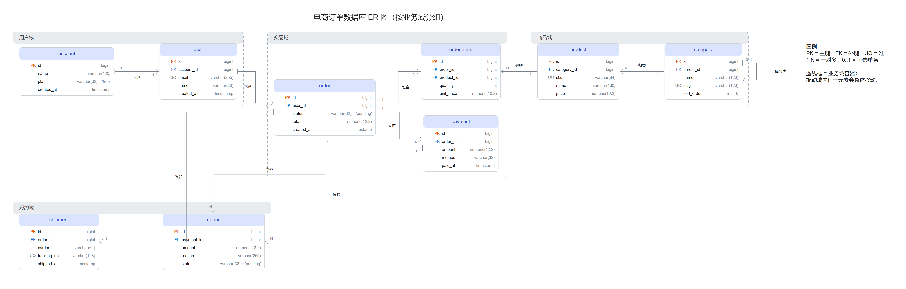
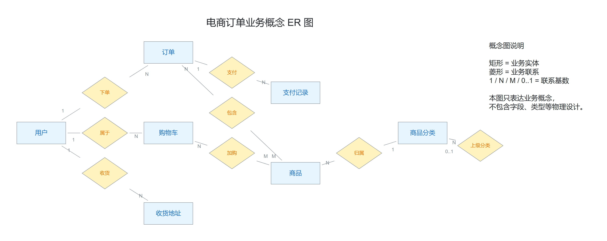
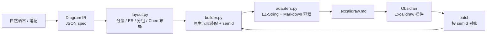

# Excalidraw Skill for Obsidian

> 让 Claude Code 用**可校验、可复现、可增量修改**的方式生成 Obsidian Excalidraw 图表。
> 纯 Python 标准库 · 6 套样式 · 流程图 / UML / ER / 分组 / 经典 Chen 概念图 · 幂等 patch · 自动备份

[](https://www.python.org/)
[](#安装)
[](scripts/tests)
[](LICENSE)

<p align="center">
  <a href="docs/images/er-shop.png">
    
  </a>
</p>

这个 Skill 把「画图」拆成两件互不混淆的事：

- **Claude** 负责理解需求、阅读笔记、设计图表的语义（节点、连线、分支、注释），输出一份 JSON **spec**。
- **Python 引擎** 负责布局、原生元素装配、ID/index 管理、LZ-String 编解码、结构校验、备份与安全写入。

因此生成的 `.excalidraw.md` 可以直接被 Obsidian Excalidraw 插件打开；后续修改走 `patch`，按稳定的 `sem_id` 做声明式对账，不会重复生成元素，也不会抹掉你手动拖过的位置。

### 能力一览

- **5 种图表模式**：流程图、UML 类图、ER 表卡片（鸦爪）、业务域分组、经典 Chen 概念 ER 图。
- **6 套样式预设**：`clean` / `er` / `chen` / `hand` / `mono` / `night`，一份 spec 一键换肤。
- **确定性布局**：流程分层 + barycenter、ER 连通分量 BFS、分组成块、Chen 菱形/标签冲突避让。
- **幂等增量修改**：`patch` 复用 id、保留手拖坐标与外观，重复执行 no-op。
- **可校验、可备份、原子写入**：纯 Python 标准库，无第三方依赖；137 个单测。

---

## 样例画廊

所有样例都由本仓库的引擎生成，图片可在 `docs/images/` 中查看原图，spec 与可直接打开的 `.excalidraw.md` 在 `examples/`。

### 1. 流程图（Flowchart）

分支、并行任务、异常补偿、汇合、旁注和边标签。

<p align="center">
  <a href="docs/images/flow.png">
    
  </a>
</p>

- Spec：[`examples/flow.json`](examples/flow.json)
- 可打开文件：[`examples/flow.excalidraw.md`](examples/flow.excalidraw.md)
- 展示：开始/结束、处理、判断、并行扇出/扇入、异常分支、分支标签、右侧说明栏。

### 2. UML 类图（Class Diagram）

三段式类框、完整属性/方法、继承 / 关联 / 聚合 / 组合 / 依赖。

<p align="center">
  <a href="docs/images/uml-classes.png">
    
  </a>
</p>

- Spec：[`examples/uml-classes.json`](examples/uml-classes.json)
- 可打开文件：[`examples/uml-classes.excalidraw.md`](examples/uml-classes.excalidraw.md)
- 展示：`uml_class` 三区类框、`inherit` 空心三角、`compose` 实心菱形、`aggregate` 空心菱形、`depend` 虚线箭头、`assoc` 普通箭头。

### 3. ER 表关系图（Crow's Foot）

数据库表卡片、PK/FK/UQ 徽标、默认值、自关联、一对多/多对多、正交连线。

<p align="center">
  <a href="docs/images/er-shop.png">
    
  </a>
</p>

- Spec：[`examples/er-shop.json`](examples/er-shop.json)
- 可打开文件：[`examples/er-shop.excalidraw.md`](examples/er-shop.excalidraw.md)
- 展示：7 张表、字段类型、PK/FK/UQ、默认值、分类自关联、`1:N` 鸦爪与 `1` 端竖杠、关系动词、图例。

### 4. 业务域分组 ER 图（Grouped Domains）

透明组容器 + 顶部色带 + 虚线边框，组内成块布局，跨域关系照常绘制。

<p align="center">
  <a href="docs/images/er-domains.png">
    
  </a>
</p>

- Spec：[`examples/er-domains.json`](examples/er-domains.json)
- 可打开文件：[`examples/er-domains.excalidraw.md`](examples/er-domains.excalidraw.md)
- 展示：用户域 / 交易域 / 商品域 / 履约域 四个容器、9 张表、组内整体拖动、跨域关系、自关联分类。
- `group` 同样可以包住 `process` / `decision` / `uml_class` 等流程与 UML 节点，不限于 ER 表。

### 5. 经典 Chen 概念 ER 图（Conceptual ER）

只表达实体、联系和基数；不生成属性椭圆或任何物理字段。

<p align="center">
  <a href="docs/images/chen-orders.png">
    
  </a>
</p>

- Spec：[`examples/chen-orders.json`](examples/chen-orders.json)
- 可打开文件：[`examples/chen-orders.excalidraw.md`](examples/chen-orders.excalidraw.md)
- 展示：7 个中文业务实体、8 条中文联系、`1:N` / `N:M` / `N:1` / `0..1:N` 基数、自关联「上级分类」、菱形/标签防重叠布局。

### 6. 六套样式预设

同一份 spec，只切换 `style`：`clean` / `er` / `chen` / `hand` / `mono` / `night`。
下图为通用流程图的四种风格；`er` 与 `chen` 是面向 ER / 概念图的专用配色（见上方样例）。

<p align="center">
  <a href="docs/images/styles.png">
    
  </a>
</p>

| 预设 | 别名 | 适用 | 特征 |
|---|---|---|---|
| `clean` | `default` / `print` | 默认、文档、工程图 | Helvetica、规整线条、浅色填充、直角 |
| `er` | `erd` / `database` / `schema` | ER / 数据库设计 | 白色圆角表卡片、淡靛蓝表头、橙色 PK / 蓝色 FK |
| `chen` | — | 经典 Chen 概念图 | 浅蓝实体、浅黄联系、细灰连线、直角 |
| `hand` | `sketch` | 白板、草图、头脑风暴 | Excalifont 手绘字体、roughness 1、马卡龙色 |
| `mono` | `grayscale` / `grey` | 打印、黑白文档 | 白灰填充、黑线、直角 |
| `night` | `dark` | 投屏、深色主题 | 深色画布、浅色线条、高对比填充 |

> 预览图由仓库内的轻量 SVG 渲染器生成，用于 README 展示；手绘抖动、字体度量等细节以 Obsidian + Excalidraw 插件的实际渲染为准。

---

## 为什么不用「让模型直接写 Excalidraw JSON」？

可以直接写，但很容易写出**能解析、却打不开/会丢东西**的文件。这个引擎把这些工作做成确定性代码：

- **稳定 ID 与 index**：元素 id 自动分配，避免重复 id、悬空绑定和错误层级。
- **语义 ID 对账**：每个引擎元素带 `customData.semId`，`patch` 按语义增量更新，重复执行无 diff。
- **格式兼容**：`.excalidraw.md` 的 LZ-String `compressToBase64`、256 字符换行、`## Text Elements`、`## Embedded Files`、`appState` 都按真实插件文件实现并做过往返校验。
- **安全写入**：写入前校验；覆盖时自动 `.bak-<时间戳>` 备份；临时文件 + 原子重命名。
- **布局与避让**：分层流程布局、ER BFS 分列、Chen 菱形/标签冲突避让、组容器成块布局。
- **可测试**：137 个 `unittest` 用例覆盖编解码、布局、样式、ER/Chen、分组、patch 与校验。

---

## 安装

### 作为 Claude Code Skill

本 Skill 是 [`wanger-skills`](https://github.com/8866nobug/wanger-skills) 仓库中的一个子目录，有两种安装方式。

**方式一：整个仓库作为 skills 目录（适合新环境）**

```bash
git clone https://github.com/8866nobug/wanger-skills.git ~/.claude/skills
```

**方式二：只安装 excalidraw（已有 `~/.claude/skills`）**

```bash
git clone https://github.com/8866nobug/wanger-skills.git /tmp/wanger-skills
cp -r /tmp/wanger-skills/excalidraw ~/.claude/skills/excalidraw
```

Windows PowerShell：

```powershell
git clone https://github.com/8866nobug/wanger-skills.git "$env:TEMP\wanger-skills"
Copy-Item -Recurse "$env:TEMP\wanger-skills\excalidraw" `
  "$env:USERPROFILE\.claude\skills\excalidraw"
```

目录名必须是 `excalidraw`，Claude Code 会读取其中的 `SKILL.md` 自动发现这个 Skill。之后可以直接说「帮我画一张……」，或使用 `/excalidraw`。

手动安装时至少需要复制：

```
excalidraw/
├── SKILL.md
├── references/
└── scripts/
```

### 环境要求

- **Python 3.10+**（开发与测试使用 3.13）；**不需要 `pip install` 任何依赖**。
- 查看/编辑图表需要 Obsidian + [Excalidraw 插件](https://github.com/zsviczian/obsidian-excalidraw-plugin)（引擎按 2.29.0 的真实文件格式实现）。
- 生成图表本身不要求安装 Obsidian；只要求能读写 `.excalidraw.md` 文件。

验证安装：

```bash
python ~/.claude/skills/excalidraw/scripts/excalidraw_cli.py new --sample -o /tmp/demo.excalidraw.md
python ~/.claude/skills/excalidraw/scripts/excalidraw_cli.py validate --path /tmp/demo.excalidraw.md
```

---

## 快速开始

### 1. 用内置样例

```bash
# 流程图（--sample 缺省即 flow）
python ~/.claude/skills/excalidraw/scripts/excalidraw_cli.py new --sample -o flow.excalidraw.md

# 表卡片 + 鸦爪 ER
python ~/.claude/skills/excalidraw/scripts/excalidraw_cli.py new --sample er -o er.excalidraw.md

# 按业务域分组的 ER
python ~/.claude/skills/excalidraw/scripts/excalidraw_cli.py new --sample er-groups -o er-groups.excalidraw.md

# 经典 Chen 概念图
python ~/.claude/skills/excalidraw/scripts/excalidraw_cli.py new --sample chen -o chen.excalidraw.md
```

### 2. 用自定义 spec

`spec` 是一份 JSON，描述**要画什么**，不描述像素坐标。最小示例：

```json
{
  "style": "clean",
  "title": "订单校验流程",
  "nodes": [
    {"kind": "terminator", "text": "开始", "sem_id": "start"},
    {"kind": "decision", "text": "校验通过？", "sem_id": "check"},
    {"kind": "process", "text": "生成订单", "sem_id": "ok"},
    {"kind": "process", "text": "返回错误", "sem_id": "fail"},
    {"kind": "terminator", "text": "结束", "sem_id": "end"}
  ],
  "edges": [
    {"src": "start", "dst": "check"},
    {"src": "check", "dst": "ok", "label": "是"},
    {"src": "check", "dst": "fail", "label": "否"},
    {"src": "ok", "dst": "end"},
    {"src": "fail", "dst": "end"}
  ]
}
```

保存为 `order.json`，然后：

```bash
python ~/.claude/skills/excalidraw/scripts/excalidraw_cli.py new \
  --spec order.json \
  -o '<Vault>/Excalidraw/order.excalidraw.md'
```

`<Vault>` 换成你的 Obsidian Vault 根目录。路径含空格或反引号时用单引号包裹。

### 3. 读取、校验与修改

```bash
# 概览：元素数 / 类型分布 / source / 校验结果
python ~/.claude/skills/excalidraw/scripts/excalidraw_cli.py get \
  --path '<Vault>/Excalidraw/order.excalidraw.md'

# 结构、ID、引用、绑定校验
python ~/.claude/skills/excalidraw/scripts/excalidraw_cli.py validate \
  --path '<Vault>/Excalidraw/order.excalidraw.md'

# 比较两份绘图
python ~/.claude/skills/excalidraw/scripts/excalidraw_cli.py diff \
  --old a.excalidraw.md --new b.excalidraw.md

# 声明式增量修改（默认保留现有位置、尺寸、箭头和外观）
python ~/.claude/skills/excalidraw/scripts/excalidraw_cli.py patch \
  --path '<Vault>/Excalidraw/order.excalidraw.md' \
  --spec order-v2.json
```

需要按新 spec 整体重排时加 `--relayout`；需要整体换风格时加 `--style night`：

```bash
python ~/.claude/skills/excalidraw/scripts/excalidraw_cli.py patch \
  --path '<Vault>/Excalidraw/order.excalidraw.md' \
  --spec order-v2.json --relayout --style night
```

`patch` 的语义：

- spec 是结构的唯一真相：新增节点会出现，spec 中删掉的引擎元素会被删除；
- 无 `sem_id` 的手绘元素永远保留；
- 默认保留你在 Obsidian 里手动拖过的坐标、改过的颜色/字体；
- 复用未变化元素的 id，重复执行不产生重复元素；
- 缺省原地回写，自动生成 `.bak-<时间戳>` 备份。

---

## Spec 参考

### 节点类型

| `kind` | 渲染为 | 用途 |
|---|---|---|
| `terminator` | 椭圆 | 开始 / 结束 |
| `process` | 矩形 | 处理步骤 |
| `decision` | 菱形 | 条件判断 |
| `uml_class` | 三段式类框 | 类名 / 属性 / 方法（用 `\n---\n` 分隔） |
| `entity` | 表卡片 | 表名 + 字段（ER） |
| `group` | 虚线容器 | 业务域 / 分组，`members` 列成员 `sem_id` |
| `text` | 独立文本 | 标题补充、画布文字 |
| `note` | 旁注文本 | 标准字体说明 / 图例 |

### 边字段

| 字段 | 说明 |
|---|---|
| `src` / `dst` | 起点 / 终点的 `sem_id` |
| `label` | 连线标签（流程分支、ER 关系动词、UML 关联名） |
| `rel` | UML 关系：`inherit` / `assoc` / `depend` / `compose` / `aggregate` |
| `cardinality` | ER 基数：`1:N` / `0..1:N` / `N:M` / `1:1`；左侧作用 `src`，右侧作用 `dst` |
| `arrow` | 普通箭头样式：`arrow` / `none` / `diamond` / `bar` |
| `sem_id` | 稳定语义 ID；同一对实体多条关系时用于区分 |

### ER 字段

```json
{
  "kind": "entity",
  "text": "order",
  "sem_id": "order",
  "fields": [
    {"name": "id", "type": "bigint", "pk": true},
    {"name": "user_id", "type": "bigint", "fk": true},
    {"name": "status", "type": "varchar(32)", "default": "'pending'"},
    {"name": "email", "type": "varchar(255)", "unique": true}
  ]
}
```

`pk` / `fk` / `unique` 生成 PK / FK / UQ 徽标；`default` 追加到类型列。

### 分组

```json
{"kind": "group", "text": "交易域", "sem_id": "grp_trade",
 "members": ["order", "order_item", "payment"]}
```

- 组框是透明底 + 顶部色带 + 虚线边框 + 左上角标题；
- 成员与组框进入同一个 Excalidraw 外层 group，拖动任意成员会整体移动；
- 只支持一层，不支持嵌套；成员必须是形状节点。

### 经典 Chen 模式

在 spec 顶层加：

```json
{"notation": "chen", "style": "chen"}
```

- `entity.label` 是中文业务实体名（缺省回退 `text`）；
- 每条 `edge.label` 是中文业务联系（必填，不从外键推断）；
- `entity.fields` 完全忽略，不生成属性椭圆、字段、类型、PK/FK/UQ；
- `cardinality` 显式给出，支持 `1` / `N` / `M` / `0..1` / `0..N` / `1..N`；
- 实体、联系、连线、基数标签自动做冲突避让；组框会包住组内联系菱形。

---

## CLI 参考

| 命令 | 用途 | 关键参数 |
|---|---|---|
| `new` | 根据 spec 生成新绘图 | `--sample [flow\|er\|er-groups\|chen]`、`--spec`、`--spec-inline`、`-o`、`--style` |
| `get` | 读取并概览绘图 | `--path` |
| `validate` | 校验结构 / ID / 引用 | `--path`；有 error 时退出码非 0 |
| `diff` | 比较两份绘图的元素差异 | `--old`、`--new` |
| `patch` | 按 spec 增量修改现有绘图 | `--path`、`--spec` / `--spec-inline`、`-o`、`--relayout`、`--style` |

引擎入口是 `scripts/excalidraw_cli.py`，可以在任意目录执行。所有写入都会先校验；`new` 覆盖已存在文件、`patch` 回写时默认备份。

---

## 工作原理



### 文件格式兼容

- `.excalidraw.md` 是 Markdown 容器，绘图数据在 `compressed-json` 代码块中；
- 压缩算法为 LZ-String 的 `compressToBase64`（桥接 UTF-16 code unit，支持 emoji / astral 字符）；
- base64 按 **256 字符**一段、段间空一行，与插件保存格式一致；
- 保留 `## Text Elements`、`## Embedded Files`、`appState`（滚动、缩放、主题）；
- 对真实插件文件做过 `parse → serialize → parse` 无损与字节级往返校验。

### 安全规则

1. 新建、完整替换、增量修改走不同路径；`new` 默认不静默覆盖。
2. 修改现有绘图前自动备份（`.bak-<时间戳>`）。
3. 写入前 `validate`，存在 error 不写入。
4. 使用临时文件 + 原子重命名，失败时保留原文件。
5. 不直接改写 Vault 中的绘图（除非通过引擎）；不触碰 `Excalidraw/Libraries/` 与 `Excalidraw/Templates/`。

---

## 目录结构

```
excalidraw/
├── SKILL.md                     # Claude Code Skill 入口、工作流、规范
├── README.md
├── LICENSE
├── references/
│   ├── elements.md              # 元素、流程图、UML、ER、Chen、旁注
│   ├── format.md                # .excalidraw.md / LZ-String / Embedded Files
│   ├── layout.md                # 布局算法与间距常量
│   └── style.md                 # 样式预设与颜色键
├── scripts/
│   ├── excalidraw/
│   │   ├── models.py            # Diagram IR + Document
│   │   ├── builder.py           # IR → 原生元素 JSON
│   │   ├── layout.py            # flow / er / grouped / Chen 布局
│   │   ├── connectors.py        # 箭头绑定、正交 ER 连线、基数解析
│   │   ├── elements.py          # 元素工厂与文本尺寸估算
│   │   ├── styles.py            # 6 套样式预设 + 默认 appState
│   │   ├── adapters.py          # LZ-String + .excalidraw.md 读写
│   │   ├── validator.py         # 结构 / 引用 / Chen 重叠与交叉校验
│   │   ├── writer.py            # 备份、原子写入
│   │   ├── diff.py              # 元素级差异
│   │   └── cli.py               # CLI 实现
│   ├── excalidraw_cli.py        # 独立启动器
│   └── tests/                   # 137 个 unittest 用例
├── examples/                    # 本文档使用的 spec 与可打开文件
└── docs/
    ├── images/                  # 样例预览（SVG + PNG）
    ├── preview_render.py        # 轻量 SVG 预览渲染器
    └── render_examples.py       # 重新生成 examples/ 与 docs/images/
```

---

## 重新生成样例

在 `excalidraw/` 目录下执行：

```bash
python docs/render_examples.py
```

- 读取 `examples/*.json`，生成 `.excalidraw.md`、`docs/images/*.svg`；
- 如果本机有 Chrome / Edge，会用无头模式生成 2x PNG；没有则跳过 PNG，已提交的 PNG 仍可直接使用；
- 只想生成 SVG：`python docs/render_examples.py --no-png`。

样例 spec 也可以直接作为模板修改：

| 文件 | 内容 |
|---|---|
| [`examples/flow.json`](examples/flow.json) | 流程图：分支、并行、异常、旁注 |
| [`examples/uml-classes.json`](examples/uml-classes.json) | UML 类图：继承、组合、聚合、依赖、关联 |
| [`examples/er-shop.json`](examples/er-shop.json) | ER：7 表、PK/FK/UQ、自关联、鸦爪 |
| [`examples/er-domains.json`](examples/er-domains.json) | 分组 ER：4 个业务域、9 张表 |
| [`examples/chen-orders.json`](examples/chen-orders.json) | Chen 概念图：7 实体、8 联系、自关联 |
| [`examples/style-gallery.json`](examples/style-gallery.json) | 样式画廊用的紧凑流程图 |

---

## 测试

```bash
# 在 excalidraw/ 目录下
cd scripts
python -m unittest discover -s tests -t .

# 或从仓库根目录
cd excalidraw/scripts
python -m unittest discover -s tests -t .
```

当前 **137 个用例**全部通过；仓库根目录的 GitHub Actions（`.github/workflows/tests.yml`）会在 Python 3.10 / 3.12 / 3.13 上运行同一套测试。覆盖：

- LZ-String 编解码、`.excalidraw.md` 往返、Embedded Files；
- flow / ER / grouped / Chen 布局与元素几何；
- 6 套样式预设与别名；
- ER 鸦爪装饰、UML 关系箭头、Chen 基数与防重叠；
- `patch` 声明式对账、no-op diff、移动实体后重算；
- validator 的悬空引用、绑定、Chen 连线交叉/块重叠。

---

## 已知限制

- 布局是启发式：流程分层 + barycenter/median 扫描、ER 连通分量 BFS、Chen 冲突搜索；复杂图仍可能需要生成后手动微调。
- 普通流程 / UML 箭头是直线；ER 连线是引擎手工路由的正交折线，跨多列的远距离边可能穿过中间卡片；不支持任意折线/拐弯箭头。
- Excalidraw 2.29.0 没有原生鸦爪箭头，鸦爪用 3 条短线元素模拟；手动拖动表卡片后装饰不会自动跟随，重新执行 `patch` 会按最终几何重算。
- 文本宽高为估算（无字体度量库），Obsidian 实际渲染后卡片可能略紧；以插件渲染为准。
- `group` 只支持一层；跨组边不参与组内排序，可能穿过组背景框。
- 经典 Chen 模式暂不支持弱实体、多值/复合属性、关系属性、全/部分参与等扩展记法，也不从外键自动推断联系。
- 引擎保留已有图片元素与 `Embedded Files`，但**不生成图片元素**。
- README 中的预览图由仓库内的简化 SVG 渲染器生成，不等同于插件渲染；手绘抖动、字体和文本换行以 Obsidian 为准。

---

## License

[MIT](LICENSE)
